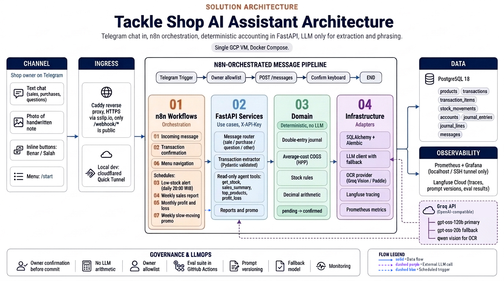
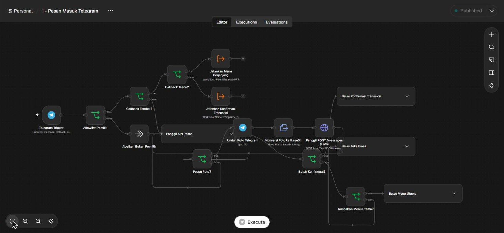
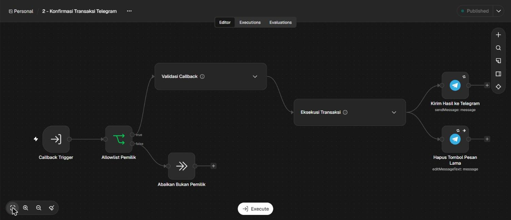
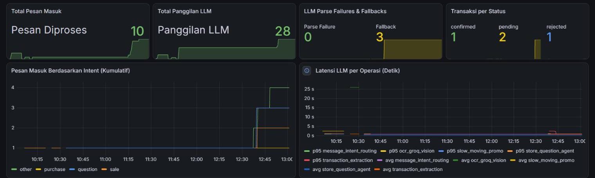
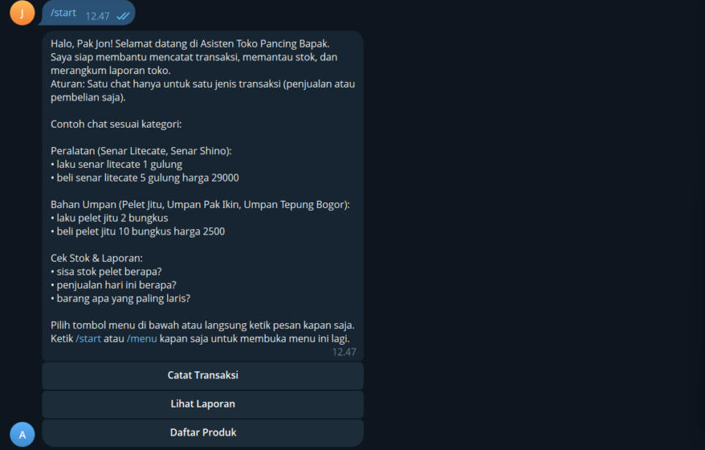
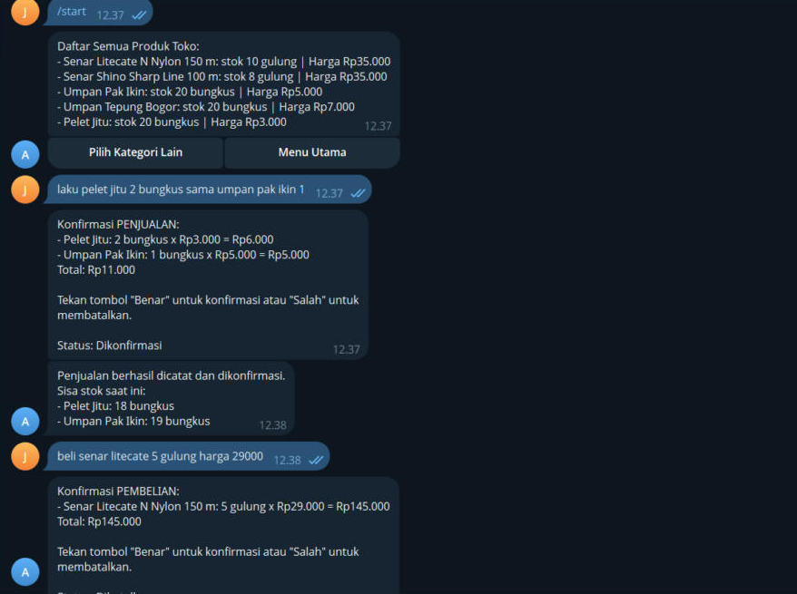
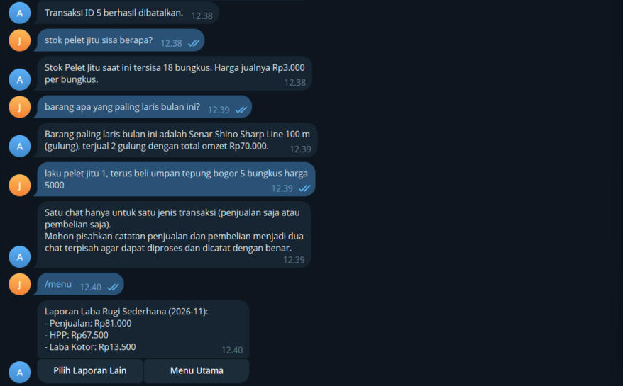

# Tackle Shop AI Assistant

An operational bookkeeping, inventory, and reporting assistant for a traditional fishing tackle shop (*toko perlengkapan mancing*). The shop owner chats naturally in Indonesian over Telegram (to log sales/purchases or ask questions about stock, revenue, and profit), while a deterministic Python backend computes all accounting entries, average-cost COGS, stock movements, and reports.

[](assets/architecture.png)

## Architecture

The system separates conversational channel handling from deterministic accounting logic:

```text
Telegram User
     │  HTTPS (/webhook/* only)
     ▼
Caddy (VM: 80/443, *.sslip.io TLS)  ───[local dev: cloudflared Quick Tunnel]
     │
     ▼  http://n8n:5678
n8n (Orchestration & Schedules)
     │  http://api:8000 (X-API-Key)
     ▼
FastAPI Backend (Clean Architecture)
  ├── api/             Request/response validation only (FastAPI)
  ├── services/        Use cases: router, extractor, transactions, reports, promo, read-only agent
  ├── domain/          Pure Python models, double-entry accounting, average-cost COGS rules
  └── infrastructure/  PostgreSQL (SQLAlchemy + Alembic), LLM client (Groq), OCR (Groq Vision / Paddle), Langfuse tracing
     │
     ├──► PostgreSQL 18 (Double-entry journals, stock movements, idempotent transactions)
     ├──► Prometheus + Grafana (Metrics & dashboards on localhost / SSH tunnel only)
     └──► Groq / OpenAI-compatible LLMs + Langfuse (Extraction, agent tool calling, observability)
```

### Core Guarantees
- **No LLM arithmetic**: The LLM extracts structured line items, classifies intent, and phrases human-readable summaries from Python-computed values. Totals, weighted-average cost (HPP/COGS), stock checks, and double-entry debits/credits are computed deterministically in `app/domain/accounting/` using `Decimal` and `NUMERIC(14, 2)`.
- **Explicit owner confirmation**: Every extracted transaction starts as `pending` and only commits stock and journal entries after the owner clicks **Benar** on the Telegram inline confirmation keyboard (`POST /transactions/{id}/confirm`).
- **Modular channel adapter**: Business logic lives in FastAPI; Telegram polling/webhooks, inline keyboards, owner allowlists, and scheduled jobs live in `n8n/workflows/`, allowing channel migration (e.g., to WhatsApp) without changing backend code.

### n8n Workflows
- `01_incoming_message.json` — Webhook entry point, owner allowlist check, temporary typing status, Telegram photo download (`file:get` -> base64), `POST /messages` routing, inline confirmation keyboard, and hierarchical `/start` / `/menu` entry.
- `02_transaction_confirmation.json` — Handles `confirm:` / `reject:` inline callbacks and removes stale buttons.
- `03_low_stock_alert.json` — Daily low-stock alert at `20:00 WIB` (`Asia/Jakarta`).
- `04_weekly_sales_report.json` — Weekly sales report every Sunday at `20:00 WIB`.
- `05_monthly_profit_loss_report.json` — Monthly simplified profit & loss report on the 1st of every month at `08:00 WIB`.
- `06_menu_navigation.json` — Stateless hybrid inline menu navigation (`menu:*` callbacks and `GET /products` by category).
- `07_weekly_slow_moving_promo.json` — Weekly slow-moving promo recommendations and bundling captions every Monday at `09:00 WIB` via `POST /promo/slow-moving`.

`01` is the single Telegram entry point: owner allowlist, button callbacks routed to sub-workflows, photo download and base64 conversion for OCR, `POST /messages`, and a reply with or without the confirmation keyboard.

[](assets/n8n_incoming_message.png)

`02` handles the **Benar** / **Salah** callbacks: allowlist check again, then confirm or reject through the API, send the result, and remove the old buttons.

[](assets/n8n_transaction_confirmation.png)

### Monitoring
FastAPI exposes `/metrics` for Prometheus, and the provisioned Grafana dashboard (`monitoring/grafana/dashboards/tackle_shop_overview.json`) tracks processed messages, LLM calls, parse failures and fallbacks, transactions by status, intents, per-operation LLM latency, token usage, and API traffic. Grafana stays on `127.0.0.1` and is reached over the SSH tunnel.

[](assets/grafana_monitoring.png)

## Telegram Bot

The owner only talks to the bot. Every reply below comes from the deployed stack (n8n on a GCP VM calling FastAPI), using the shop's seed products.

**Menu and examples:** `/start` or `/menu` shows the rules (one transaction type per chat), example messages per product category, and inline menu buttons.

[](assets/telegram_start_menu.png)

**Recording transactions:** a free-form sale message is extracted into line items, priced from the product table, and held as `pending`. Stock and journal entries change only after the owner taps **Benar**; **Salah** cancels the draft.

[](assets/telegram_transactions.png)

**Questions, guardrails, and reports:** stock and best-seller questions go to the read-only agent (tool calls only, numbers come from SQL). A message mixing a sale and a purchase is rejected by a template without calling the LLM. The report menu returns the monthly simplified profit and loss.

[](assets/telegram_agent_reports.png)

## Design Decisions

Key architectural and operational choices are documented chronologically in [`docs/decisions.md`](docs/decisions.md), alongside the system specification in [`docs/spec.md`](docs/spec.md):
- **Clean Architecture & pure domain layer**: `app/domain/` has zero imports from FastAPI, SQLAlchemy, or LLM SDKs, keeping accounting invariants testable in isolation.
- **Weighted-average cost (HPP rata-rata)**: Simpler and better suited to uniform unit-bought/unit-sold inventory than FIFO lot tracking for v1.
- **Groq OpenAI-compatible inference + fallback**: Primary `openai/gpt-oss-120b` with Pydantic validation retry and automatic fallback to `openai/gpt-oss-20b`.
- **Configurable receipt OCR (`OCR_PROVIDER`)**: Defaults to `groq_vision` (`qwen/qwen3.8-27b` routed through `LLMClient` + `prompts/ocr_v1.txt`) with an optional lazy-imported local `PaddleOCRProvider` adapter (`paddle`), piping transcribed receipts straight into `TransactionExtractor` (`source=photo`).
- **Deterministic slow-moving bundling**: `POST /promo/slow-moving` calculates slow-moving stock stats and candidate bundle prices (up to 5% discount rounded in Rp500 steps, strictly above combined `avg_cost`) in Python before asking `promo_v1` to write promotional captions.
- **Stateless hybrid Telegram menu**: Sub-workflow navigation callbacks (`menu:*`) stay separated from transaction confirmation (`confirm:`/`reject:`), while allowing free-form chat at any time.
- **IPv4-first DNS in n8n & idempotent webhook republish**: `NODE_OPTIONS=--dns-result-order=ipv4first` prevents container IPv6 timeouts to `api.telegram.org`, and deployment scripts republish webhook workflows so Telegram targets the active host reliably.
- **Single-VM GCP deployment with `sslip.io` + Caddy**: Avoids buying a domain or running Cloudflared on GCP while strictly exposing only `/webhook/*` over automatic Let's Encrypt HTTPS on ports `80/443`.

## Running Locally (Development)

> **Important**: Telegram allows only one active webhook URL per bot token. Do not run local `n8n` + `cloudflared` at the same time as the GCP VM unless you intentionally want to switch the webhook target.

### Prerequisites
- Docker & Docker Compose
- Python 3.13+ with [`uv`](https://docs.astral.sh/uv/)
- Telegram Bot token + owner chat ID (`TELEGRAM_OWNER_CHAT_ID`)
- LLM API key (Groq) and optionally Langfuse keys

### Manual First-Time Setup
1. Copy `.env.example` to `.env` and fill in the required secrets (`LLM_BASE_URL`, `LLM_API_KEY`, `API_SECRET`, `POSTGRES_PASSWORD`, `N8N_ENCRYPTION_KEY`, `TELEGRAM_OWNER_CHAT_ID`).
2. Start the stack and wait for PostgreSQL to become healthy:
   ```powershell
   docker compose up -d
   ```
3. Run database migrations and initial seed (chart of accounts + 5 initial fishing tackle products):
   ```powershell
   docker compose exec api alembic upgrade head
   docker compose exec api python -m app.infrastructure.db.seed
   ```
4. Capture the temporary Cloudflare Quick Tunnel URL from logs (`docker logs tackle-cloudflared`), update `WEBHOOK_URL` in `.env`, recreate `n8n`, configure n8n credentials (`Telegram Bot` and `Header Auth` for `X-API-Key`), import `n8n/workflows/*.json`, and publish the workflows.

### One-Click Local Restart (After GCP VM Teardown)
After the GCP VM has been torn down (or when operating purely locally), run [`start.bat`](start.bat) from the project root. It starts Docker Compose, extracts the latest Quick Tunnel URL from `tackle-cloudflared`, updates `WEBHOOK_URL` in `.env`, recreates `n8n`, republishes the Telegram webhook workflow, and displays service status.

### Quality Checks & Evaluation
```powershell
uv sync --all-groups
uv run black --check .
uv run pylint app
uv run pytest
```
Run live LLM extraction/routing/agent evals against `evals/datasets/`:
```powershell
uv run python evals/run_eval.py
```

## Deploying & Operating on GCP VM

The production deployment runs on a single Google Compute Engine VM (`e2-standard-2`, Ubuntu 24.04 LTS, 30 GB disk, zone `asia-southeast2-a`) behind a reserved static IP and a dedicated VPC (`tackle-shop-vpc`).

- **Public ingress firewall**: Only ports `80` and `443` (`tcp`) are open to `0.0.0.0/0` (`tackle-shop-allow-web`).
- **Caddy reverse proxy (`deploy/Caddyfile`)**: Provisions automatic HTTPS via `<IP-with-dashes>.sslip.io` and forwards **only** `/webhook/*` to `n8n:5678`. All other paths (such as `/` and `/healthz`) return `404`.
- **Internal services**: `postgres` (`5432`), `n8n` editor/API (`5678`), `api` (`8000`), `prometheus` (`9090`), and `grafana` (`3001`) bind strictly to `127.0.0.1` in `docker-compose.prod.yml`.
- **SSH access**: Port `22` is restricted to Google Identity-Aware Proxy (`35.235.240.0/20`, `tackle-shop-allow-iap-ssh`).

### Idempotent Deployment (`scripts/deploy_gcp.ps1`)
After pushing changes to `main`:
```powershell
powershell -ExecutionPolicy Bypass -File .\scripts\deploy_gcp.ps1
```
This script resolves the static IP, pulls `origin/main` on the VM, generates and uploads the production `.env` (setting `WEBHOOK_URL`, `SSLIP_HOST`, and `OCR_PROVIDER=groq_vision` without printing secrets), builds/starts `docker-compose.prod.yml`, runs `alembic upgrade head` and idempotent `seed.py`, and imports/republishes `n8n/workflows/*.json`.

### Accessing Internal Dashboards & UIs via SSH Tunnel
Because Grafana, Prometheus, n8n Editor, and FastAPI are bound to `127.0.0.1` on the VM, forward those ports over IAP SSH when you need to inspect dashboards or workflows:
```powershell
gcloud compute ssh tackle-shop --project=neat-geode-514006-g4 --zone=asia-southeast2-a --tunnel-through-iap -- -L 5678:127.0.0.1:5678 -L 3001:127.0.0.1:3001 -L 9090:127.0.0.1:9090 -L 8000:127.0.0.1:8000
```
While the tunnel session stays open:
- n8n Editor: `http://localhost:5678`
- Grafana Dashboards: `http://localhost:3001`
- Prometheus: `http://localhost:9090`
- FastAPI OpenAPI docs: `http://localhost:8000/docs`

## Backup & Teardown Before 26 November 2026

> **Credit expiry reminder**: GCP credits expire on **26 November 2026**. Run backup and teardown before that date (recommended: **24 November 2026**) so no post-credit charges occur.

Run [`scripts/teardown_gcp.ps1`](scripts/teardown_gcp.ps1):
```powershell
powershell -ExecutionPolicy Bypass -File .\scripts\teardown_gcp.ps1
```
What the script does safely in order:
1. Executes `pg_dump` inside `tackle-postgres` and exports all n8n workflows on the VM into `backups/<timestamp>/` (gitignored).
2. Verifies non-empty backup files on your local machine.
3. Starts local `postgres` and restores the VM SQL dump into your local database so no transaction history is lost.
4. Prompts you to type **`HAPUS`** (exact uppercase confirmation) before deleting the VM, persistent boot disk, static IP, firewall rules, subnet, and VPC.
5. Afterward, run `start.bat` locally whenever you want to switch Telegram back to your laptop.

## Roadmap

Planned extensions beyond v1 (see `docs/spec.md` & `docs/tasks.md`):
- **Expanded accounting statements**: Trial balance (*neraca saldo*), adjusting journal entries (*jurnal penyesuaian*), balance sheet (*neraca*), owner's equity statement, and operating expenses tracking.
- **Unit conversion & product variants**: Buying in bulk packs while selling per piece (e.g., hooks packed 13/pack), and handling size/gauge variants (hook sizes 1–15, line diameters).
- **Non-cash payment methods**: Credit/receivables (*piutang*), payables (*utang*), QRIS, and bank transfers beyond cash-only v1.
- **Channel expansion**: Adding WhatsApp via n8n nodes without modifying FastAPI business logic.
- **Automated CI/CD (Task 15, optional)**: Building commit-SHA Docker images after CI + eval pass and automating rollbacks.
